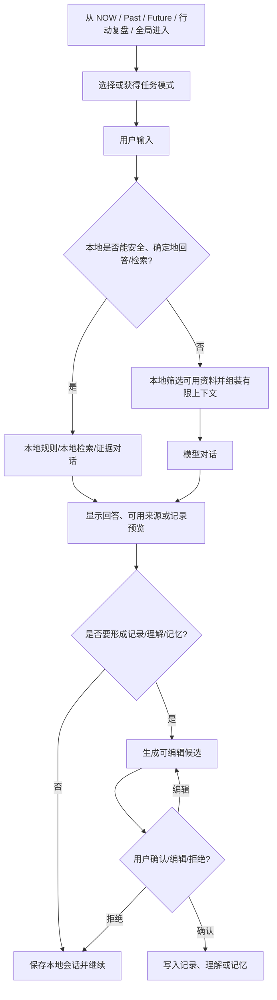
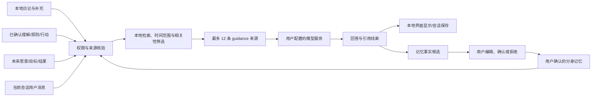
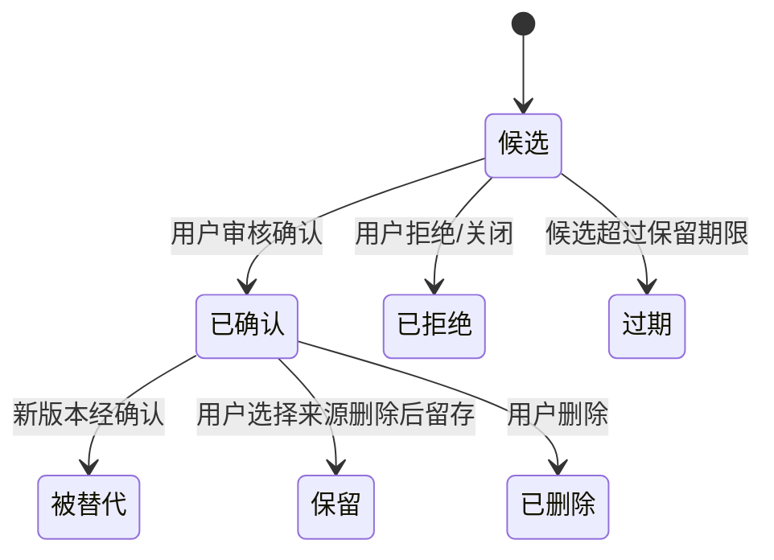

# VECTOR「分身」功能全景总结

> 版本范围：当前最新源码工作区 `.latest/vector-github`（GitHub 基线提交 `0b135be4f1fd21ad7fb472126ab30e8139254178` 及其工作区内已存在的改动）。本文是基于代码结构、界面与随附测试/交付记录的静态梳理，不代表真实模型效果或用户研究结论。本文只描述已能从当前实现确认的行为；未验证项单独列出。

## 1. 功能定位

分身是 VECTOR 内的个人对话与经验回看能力：用户可以记录当下、整理经历、检索过往、比较选择、复盘结果，并在明确审核后把稳定信息沉淀为可管理的记忆。它连接 NOW（日常记录）、Past（经历/原则/行动）与 Future（愿景/目标/行动），但生成的建议不会自动变成记录、长期记忆或未来承诺。

当前实现包含两种可见工作区：

- **上下文任务对话**：围绕某条经历、搜索结果、未来目标或行动复盘进入，按任务使用不同模式。
- **全局分身工作区**：通用聊天、记忆库、备份/恢复，以及模型接入设置。

## 2. 入口与六种模式

| 模式 | 主要目的 | 常见来源/动作 | 主要产物 |
|---|---|---|---|
| `capture` 帮我记录 | 把当下表达整理为可编辑记录 | NOW | 记录预览，用户可确认保存 |
| `distill` 帮我整理 | 梳理一段经历并形成理解候选 | NOW / Past | 理解候选，需用户审核 |
| `recall` 问问过去 | 检索相关过去记录并回答问题 | Past 详情 / 搜索 | 回答及可回看的来源 |
| `decide` 帮我分析 | 结合当下问题和相关资料比较选择 | NOW / Future | 对话分析/建议 |
| `review` 回顾结果 | 结合行动结果回看此前理解 | 行动复盘 | 对话分析/可能的更新候选 |
| `general` 通用分身 | 自由对话，连接过去、现在与未来 | 全局入口 | 聊天、记忆审核、备份等 |

启动上下文类型为 `AvatarLaunchContext`：模式、来源以及可选记录/行动 ID、查询和提示。来源枚举包括 NOW、Past 详情、Past 搜索、Future、行动复盘和全局入口。入口上下文用于限定任务与关联对象，并不自动授予对所有资料的访问权。

## 3. 用户流程

**重要区别：**回答建议、候选记忆、已确认记忆、用户记录及未来行动是不同状态。对话中的“可以”“试试”等自然语言本身不等于确认写入。

## 4. 资料流与隐私边界

代码层可确认的边界与限制：

- 私密、锁定、封存、加密或权限已撤销的记录不应作为可读上下文来源；依赖这些记录的派生内容（如理解、原则、行动或未来资料）会做来源可达性检查。
- 来源预览会根据当前原始记录、消息和权限重新核验；缓存的摘要/摘录本身不足以证明来源仍有效。某些旧资料删除后，若用户明确选择保留，可能保留为“删除来源后保留”的记忆，但可追溯性会因此减少。
- AI 权限 token 在请求前后复核；期间发生锁定、账号/会话变化或权限变化时中止并拒绝过时响应。中止请求**不能撤回已经传给模型服务商的数据**。
- 对话/会话、普通本地存储、模型密钥存储、加密备份属于不同边界。该功能不能据此宣称整个本地数据库都已静态加密。
- Guidance 来源在客户端本地组织和裁剪，最多发送 12 条；对话/抽取请求最多携带最近 120 条消息。每条长证据摘录最多 700 字符，供模型理解的问题相关片段优先。
- 分身记忆抽取 API 仅把用户发言作为事实证据；assistant 回复可用于处理用户确认、修正或拒绝的语境，不能作为用户事实来源。

## 5. 记忆与知识生命周期

### 两类主要记忆对象

1. **理解版本（Understanding）**：以“过去模式”为主，有 pending / confirmed / rejected / superseded 状态；可关联来源记录、前一版本、时间和模式维度。只有用户确认的理解才进入当前可信资料。
2. **原子记忆（Atomic memory）**：细粒度陈述，可按类别、维度/Facet、标签、场景、敏感级别、有效时间、来源和置信排序值管理。性质包括经历、明确表达、推断、承诺、状态；状态包括候选、确认、被替代、拒绝、保留。

关系类型还可表达支持、矛盾、更新、派生、约束、服务、验证、同场景等知识关联。它提供了更丰富的组织模型，但不能假定每条记忆都已有可靠或完整的关系网络。

### 候选审核链

- 模型候选最多三条，并需给出用户消息索引与原文证据片段；服务端校验索引指向 user 消息，且引文确实存在于对应原文中。
- 候选可以编辑、分类、加标签、设敏感度/AI 可见性；确认才写入。支持候选来源预览及已确认记忆版本比较。
- 推断型认知模式需要更高门槛：至少两个独立经历来源，或至少三个不同用户消息，并跨日期或跨独立会话，才进入确认准备状态。
- 候选有 24 小时 TTL；会话本地最多保留 18 个会话，每会话最多 600 条消息。实际模型提示另有 120 条上限。
- 记忆库 UI 目前作为全局分身工作区的一部分，支持浏览/复核，不代表已实现完整知识图谱可视化或自动的无误冲突解决。

## 6. 对话与检索策略

- 本地先判断部分确定性任务：如记录条数/证据问题、Past 检索、理解修正和备份/安全/草稿等可靠性任务；其余需要自然语言理解时才走模型请求。
- Recall 模式先用当前可访问的 Past 记录检索，并把匹配结果显示为来源；有来源关联的回答可以回到原记录。
- 通用上下文会组合可访问经历、确认理解、原则、行动、未来目标/愿景、用户确认记忆。会区分当前理解、历史事实、历史理解和限时状态，避免把过往资料直接说成用户现状。
- 行动的结果反馈也进入建议边界：已完成不等于有效，未完成/取消不证明原则无效；无结果描述时保留未知。
- 聊天提示协议要求自然对话、证据边界、时间区分、修正后停止重复推断。提示与规则只能降低风险，不能保证所有模型输出都遵守。

## 7. 形成记录、理解与未来方向

- **记录**：capture 流程提取可记录信息，生成可编辑的 NOW 预览；内容不足时会追问或要求补充具体事实。用户经界面确认后保存。
- **理解**：对话可生成结构化理解预览，关联证据记录；写入后仍需确认。修改旧理解会产生版本关系，而不是自动宣称真实成长。
- **记忆**：可通过聊天后的候选抽取或用户主动添加；确认前不应作为已知长期记忆使用。
- **未来方向**：growth preview 能基于用户明确提供的消息/证据生成信号和成长草稿；草稿不是现状事实，保存方向/目标需要用户操作。当前代码对于来源消息和选定经历做了边界校验。

## 8. 模型接入、会话及维护能力

- 支持应用内置模型 Provider 路径和用户配置的兼容模型服务；配置包括 Base URL、Key、模型名称以及 chat/responses 接口类型，并可测试连接/列出模型。
- Key 默认可记住在当前设备的本地存储偏好中，也可选择仅在会话存储；Key 的设备存储不是端到端加密承诺。用户应将服务商视作会收到实际发送内容的一方。
- 网络失败、超时、认证失败、权限、额度、模型不可用、格式错误等有可理解的诊断文案，失败消息/设置会保留以供重试。
- 会话在本地存储；通用模式可恢复旧版本中分散的会话消息。界面有聊天、记忆库、备份/恢复和模型设置入口。备份/恢复的加密强度取决于用户是否启用密码保护。
- 浏览器关闭/存储被清理、跨设备恢复和导入合并行为要按账号、浏览器存储及备份实际配置判断，不能将本地会话说成云端同步。

## 9. 主要实现模块地图

| 责任 | 关键文件 |
|---|---|
| 模式、启动来源、会话/记忆数据类型 | `features/avatar/types.ts` |
| 聊天页面流程、请求编排、证据呈现 | `features/now/components/AvatarChatPage.tsx` |
| 对话/记忆库/备份/模型设置界面 | `features/now/components/AvatarChatSurface.tsx` |
| 中英模式标签 | `features/now/components/avatarModeCopy.ts` |
| 聊天、摘要、抽取与增长预览客户端 API | `features/now/api/avatar.ts` |
| AI 请求权限 token、账号和锁定边界 | `features/now/api/avatarRequest.ts`、`services/aiPrivacy.ts` |
| 记忆抽取候选、编辑和确认链 | `features/now/hooks/useAvatarMemoryCapture.ts`、`server/avatarFactExtraction.ts` |
| 记忆浏览与复核 | `features/now/components/AvatarMemoryLibrary.tsx`、`AvatarMemoryConfirm.tsx` |
| 会话/记忆/来源持久化 | `services/avatarMemorySessions.ts`、`services/avatarMemoryAtoms.ts`、`services/avatarSourceEvidence.ts` |
| 授权资料构建、检索与裁剪 | `services/avatarGuidanceSources.ts`、`services/avatarGuidance.ts`、`services/guidanceResults.ts` |
| 服务端对话/模型调用及增长预览 | `server/avatarChatRoutes.ts`、`server/avatarGrowthRoutes.ts`、`server/aiProviders.ts` |
| 行为协议、回答边界 | `services/avatarWorkProtocol.ts`、`services/avatarBehaviorStandard.ts` |
| 模型配置、兼容接口和诊断 | `features/now/api/avatarModel.ts`、`features/now/components/AvatarModelSettings.tsx`、`server/avatarCustomModel.ts` |
| 确定性 Avatar 测试与评估语料 | `features/now/components/*Avatar*.test.tsx`、`services/*avatar*.test.ts`、`server/avatarChatRoutes.test.ts`、`evals/avatar/` |

## 10. 现有能力与证据强度

### 代码/工程层面可确认

- 六种任务模式及多个模块入口；本地会话持久化和通用聊天恢复。
- 来源组装、相关性检索、有限上下文、来源预览及权限撤销检查。
- 记忆候选审核、原文证据校验、推断模式的证据门槛、版本和来源管理。
- 模型配置/连通性诊断/重试、双语核心 UI、备份工作区。
- 存在对应单元、组件和端到端测试。当前 P0–P2 交付记录报告 Vitest 1,357 项通过，Playwright 35/36；桌面未来草稿刷新用例有 1 项失败。详见 `docs/current/p0-p2-delivery.md`。此数字是该交付记录的测试结果，不自动代表当前工作树再次运行的结果。

### 不能由当前代码/工程测试推断

- 不能据此证明真实模型在中文长期对话、复杂记忆冲突、心理支持、不同供应商之间的质量一致性。
- 确定性 holdout 覆盖代码规则，不等于真实模型盲测或用户研究。
- 来源定位与引用正确不等于语义总结正确、因果推断成立或幻觉为零。
- 客户端权限/撤权代码不等于第三方安全审计，也不能撤回已发送给服务商的数据。
- P0–P2 交付记录明确整库加密设计完成但实施未开始；付费授权生命周期、Stripe 沙箱、真实用户试用、实体设备/弱网验证与移动性能门槛仍有缺口。

## 11. 面向下一轮优化的判断与行动计划

| 优先级 | 问题/机会 | 建议动作 | 验收信号 |
|---|---|---|---|
| P0 | 用户难判断分身此刻引用了什么、覆盖了多少资料 | 在回答处提供可展开的来源/时间范围说明；空结果明确“搜索了哪些资料范围”；来源不可访问时不展示陈旧引用 | 权限矩阵测试 + 用户能分辨“自述/日记/推测/历史” |
| P0 | “候选、已确认、当前、历史”状态容易混淆 | 对话中统一候选、确认、替代、拒绝和保留的状态文案；记忆确认前明确 AI 可见性 | 状态迁移测试；确认前后上下文差异测试 |
| P0 | 撤权发生在发送之后不能收回内容 | 将发送前授权提示、服务商数据流告知和撤权时点写清；缩小默认上下文并减少敏感内容 | 浏览器请求断言 + 明确的用户可理解告知；不承诺撤回 |
| P1 | 六模式间任务边界与产物不够直观 | 在入口展示“这次会做什么/不会自动保存什么”，并让用户可切换任务 | 首次使用可完成率、误触发/返回率、模式选择访谈 |
| P1 | Past 检索质量和答案证据覆盖尚未实证 | 构建真实脱敏问题集，评估召回率、来源正确率、时间错置和遗漏反例 | 盲评 + 每类最低门槛；按中英文/数据量切片报告 |
| P1 | 记忆质量有误抽、重复、过时和敏感误收风险 | 评估抽取精确率、重复合并、冲突/替代、候选过期及撤销链；提供批量检查和删除后影响预览 | 人工标注集 + 记忆操作可追溯验收 |
| P1 | 模型服务商与本地 Key 的边界容易被误解 | 设置页解释发送内容、服务商责任及 Key 保存选项；测试错误恢复和 Key 清除 | 可用性测试 + 不同接口/Provider 故障矩阵 |
| P2 | 记忆关系模型丰富但用户理解成本高 | 先改善检索、标签与版本比较，再以用户任务验证关系图/模式视图 | 任务成功率与理解正确率优于简单列表后再扩展 |
| P2 | 当前状态需持续回归 | 建立小规模可重复真实模型评测与实体设备性能/隐私请求回归 | 记录模型、提示版本、语料、评分者及失败样本；与确定性测试分开 |

建议实施顺序：先做“证据与状态可见性 + 权限告知”（P0），然后用脱敏真实问题集验证检索与记忆质量（P1），最后再投入关系图或主动式能力。每阶段保留反例集，不能只按回答流畅度打分。

## 12. 一句话总结

当前分身已经从单轮聊天扩展成“多入口任务对话 + 本地证据检索 + 用户审核记忆 + 未来方向草稿”的个人经验工作流；它的优势在于来源与权限边界、记忆确认机制及可追溯的数据结构，核心待验证项是端到端可理解性、真实模型的证据正确率、跨时间推断质量和真实用户价值。
